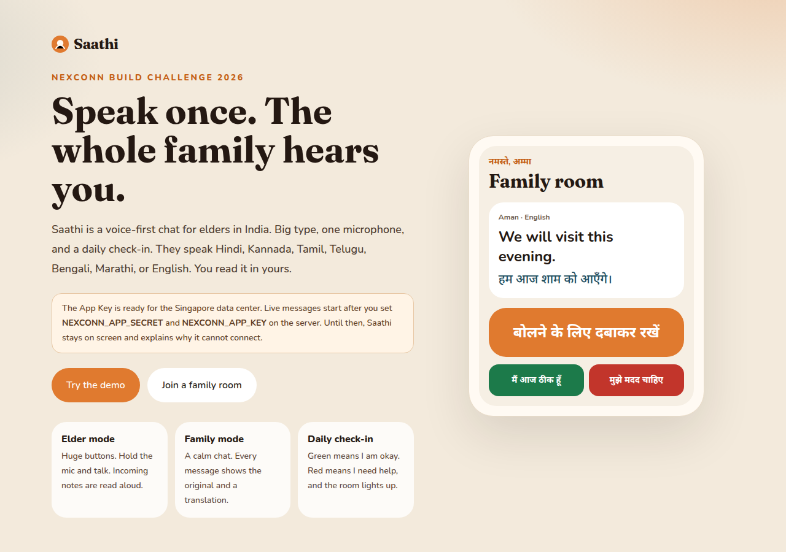
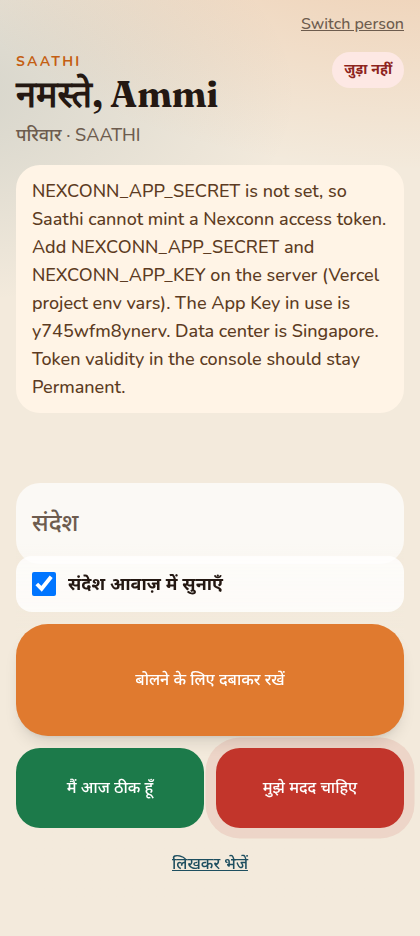
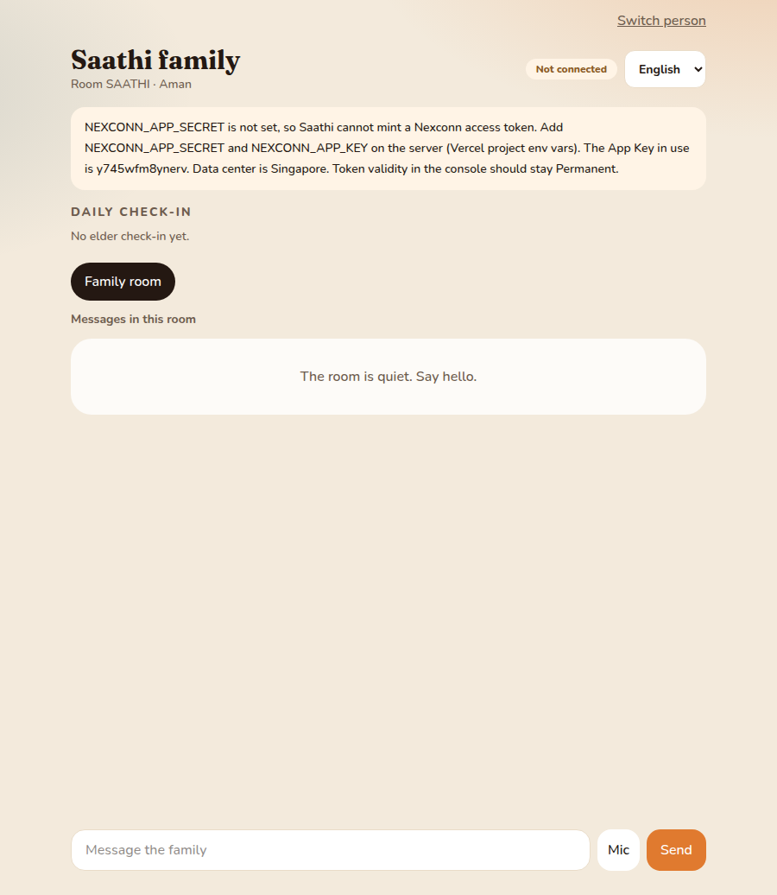
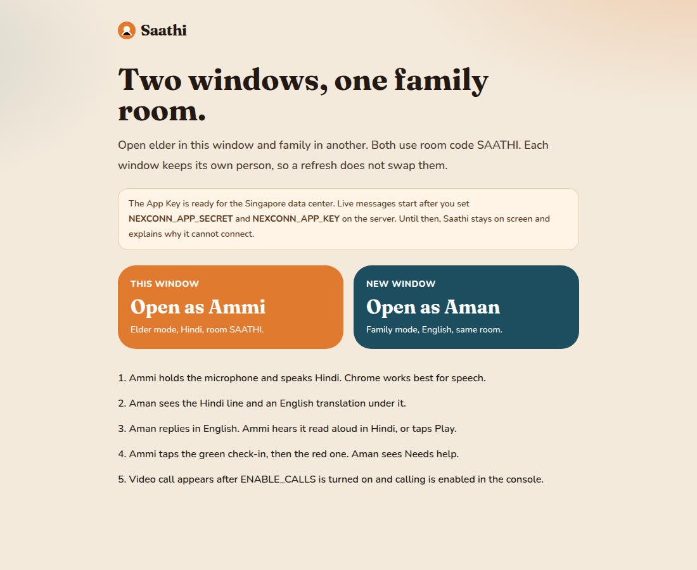

# Saathi

Saathi is a voice-first family chat for elders in India. An elder holds one large button and speaks. The family reads the original line plus a translation. A daily check-in tells everyone "I am okay" or "I need help".

Built for the Nexconn Build Challenge 2026, Humanitarian and Social Good track. Messaging uses the Nexconn Web Chat SDK. 1:1 video is wired with the Nexconn Call SDK and stays behind a flag until calling is enabled in the console.

## Screenshots









## What uses the Nexconn SDK

Chat UI web components are not mounted. The screens are custom so elder mode can stay at two or three huge controls. Every message still goes through the Chat SDK.

Client (`src/lib/nexconn/session.ts`), package `@nexconn/chat` 26.2.0 with `@nexconn/engine` 26.2.0:

- `NCEngine.initialize({ appKey, areaCode: AreaCode.SG, logLevel: LogLevel.WARN })` once. `AreaCode.SG` selects the Singapore data center and its navigator.
- `NCEngine.addConnectionStatusHandler` with `ConnectionStatusHandler.onConnectionStatusChanged`.
- `NCEngine.addMessageHandler` with `MessageHandler.onMessageReceived`, registered before `connect`.
- `NCEngine.connect({ token })`. The token comes from the server route, never from the browser secret.
- `NCEngine.userModule.updateMyUserProfile` with `extProfile.role` and `extProfile.language`.
- `GroupChannel.createGroup({ groupId, groupName, joinPermission: GroupJoinPermission.FREE, invitePermission: GroupOperationPermission.EVERYONE })`.
- `GroupChannel.join` when the room already exists (code `25409`). Already a member (`25412`) is treated as success.
- `GroupChannel.setMemberInfo` stores the display name plus `{ role, language }` in member `extra`.
- `GroupChannel.createGroupMembersByRoleQuery` for owner, admin, and normal members.
- `new GroupChannel(roomId).sendMessage(new SendTextMessageParams({ text, extra }))`.
- `params.metadata` carries `lang`, `role`, `kind`, and `status`. The same payload is in message content `extra`, which is the custom field other clients can read.
- `new DirectChannel(peerId).sendMessage(...)` for 1:1 notes.
- `BaseChannel.createMessagesQuery` and `loadNextPage` for group and direct history.
- `Helper.createSendHDVoiceMessageParams(file)` then `channel.sendMediaMessage` for a short family voice note.

Server (`src/app/api/nexconn/token/route.ts` and `src/lib/nexconn/platform.ts`):

- `POST https://api.sg-light-api.com/v4/auth/access-token/issue` with `{ userId, name }`.
- Headers: `App-Key`, `Nonce`, `Timestamp`, `Signature`.
- `Signature` is the hex SHA1 of `App Secret + Nonce + Timestamp`, with no separator.
- Backup host `api-b.sg-light-api.com` is tried if the primary call fails.
- If `NEXCONN_APP_SECRET` is missing the route returns HTTP 503 and a plain explanation. The secret is never sent to the browser.

Call SDK (`src/lib/nexconn/calls.ts`), package `@nexconn/call` 26.2.1, only when `ENABLE_CALLS=true`:

- `NCCallEngine.install()` before `NCEngine.initialize`.
- `NCCallEngine.initialize({})`.
- `setCallEventHandler` for `onCallReceived`, `onCallConnected`, `onCallEnded`, and `onRemoteUserStateChanged`.
- `setLocalVideoView` and `setRemoteVideoView`.
- `startCall({ calleeIds, callType: NCCallType.SINGLE, mediaType: NCCallMediaType.AUDIO_VIDEO, extra: "saathi" })`.
- `acceptCall({ callId })` and `endCall({ callId })`.

## Setup

```bash
npm install
cp .env.example .env.local
npm run dev
```

Open http://localhost:3000. The App Key defaults to `y745wfm8ynerv`, so the client can initialize before you copy env files. Live send and receive stay off until the secret is present.

Deploy on Vercel as a normal Next.js app. Set the env vars below, then deploy. `NEXT_PUBLIC_*` values are read at build time. `NEXCONN_APP_SECRET` and `ENABLE_CALLS` are read on the server at request time.

## Env vars

- `NEXT_PUBLIC_NEXCONN_APP_KEY`, optional. Client App Key. Defaults to `y745wfm8ynerv`.
- `NEXT_PUBLIC_NEXCONN_AREA`, optional. Kept for docs. The SDK is always initialized with `AreaCode.SG`.
- `NEXCONN_APP_KEY`, required on the server. Same App Key, used to sign Platform API calls. Defaults to `y745wfm8ynerv` if unset.
- `NEXCONN_APP_SECRET`, required for live chat. App Secret from Key Management. Server only.
- `NEXCONN_API_BASE`, optional. Defaults to `https://api.sg-light-api.com`.
- `ENABLE_CALLS`, optional. Set to `true` to show the video call button. Default is off.
- `NEXT_PUBLIC_ENABLE_CALLS`, optional. Same flag, useful if you prefer a build time value.
- `GROQ_API_KEY`, optional. Prefer Groq for translation when set.
- `GEMINI_API_KEY`, optional. Used when Groq is empty.

## What to click in the Nexconn console

1. Sign in at https://console.nexconn.ai.
2. Open the app whose App Key is `y745wfm8ynerv`.
3. On Key Management, confirm the data center is Singapore. Copy the App Secret into `NEXCONN_APP_SECRET`. Leave the secret out of git and out of any `NEXT_PUBLIC_` variable.
4. Token validity is already Permanent. Leave it that way. Saathi asks for a token each time a window opens and does not depend on expiry.
5. For video only: open Audio/Video Calling and enable the service. Then set `ENABLE_CALLS` to `true` and redeploy. Calls need HTTPS, or localhost. Until then the button is hidden and chat still works.
6. Optional: add `GROQ_API_KEY` or `GEMINI_API_KEY` in Vercel if you want an LLM translator. Without them, Saathi still translates.

## How to run the demo

1. Put the App Secret in `.env.local` or in Vercel.
2. Open `/demo`.
3. Choose "Open as Ammi" in this window (elder, Hindi, room `SAATHI`).
4. Choose "Open as Aman" so it opens a second window (family, English, same room).
5. Each window stores its own person. Elder is `localStorage` key `saathi.profile.elder`. Family is `saathi.profile.family`. The seat id lives in `sessionStorage`, so two windows do not overwrite each other.
6. Allow the microphone in the elder window. Hold the orange button and speak. Chrome has the speech recognizer this flow needs. If the mic is blocked, use "Type instead".
7. On the family window, the Hindi line appears with English under it. Reply in the composer. The elder window reads the reply aloud in Hindi, and each card has a Play button.
8. Tap the green check-in, then the red one. The family window shows a Needs help banner and the time of the last check-in.
9. A family Mic button records up to 8 seconds and sends it as an HD voice message when the SDK accepts the file.

There is no real login. The user id is the name plus a random suffix, letters and numbers only, saved on this phone.

## Translation

Each message stores the speaker language in `extra` and in `metadata`. The reader asks `/api/translate`.

Order:

1. Groq `llama-3.1-8b-instant` if `GROQ_API_KEY` is set.
2. Gemini `gemini-2.0-flash` if `GEMINI_API_KEY` is set.
3. A no-key web translate endpoint (`clients5.google.com/translate_a/t`, `client=dict-chrome-ex`).
4. MyMemory if that endpoint fails and the daily free quota is still open.
5. If all of them fail, the screen keeps the original and says translation is unavailable. Elder playback then speaks the original text.

## Scripts

- `npm run dev` starts the app.
- `npm run build` creates the production build.
- `npm run start` serves that build.

`npm run build` passes without the App Secret. Connecting to Nexconn does not.
